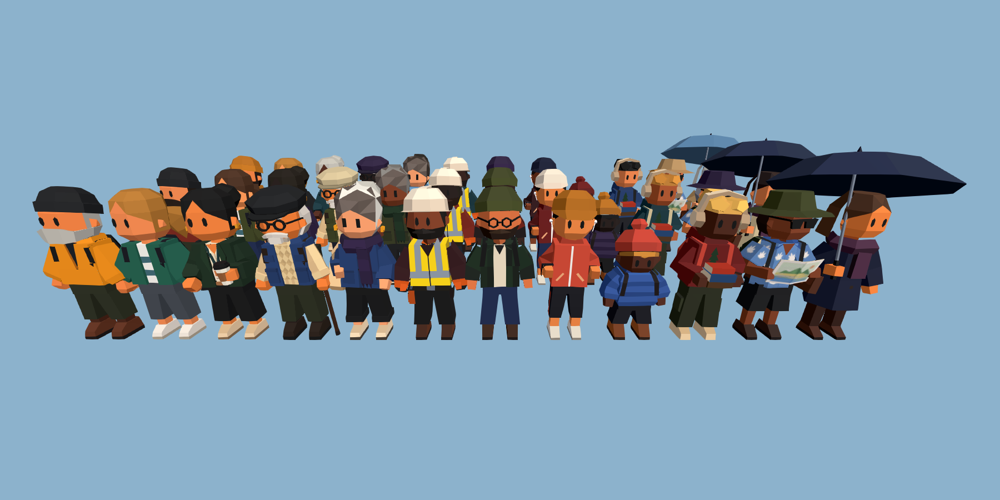

# Recolour tags for people models: instructions for Gemini

Walk-on passengers get random skin, hair, clothes and accessory colours in game.
For that to work, each person script labels which palette colours belong to
which part, using the shared helper `art/person_recolor.py`. Paste the block
below into the Gemini prompt for every new person model.



---

## Paste into the Gemini prompt

Every person script must tag its recolourable parts with the shared helper
`art/person_recolor.py`. Do this:

1. Keep every colour as a named palette constant made with `col_srgb(...)`
   (for example `HAIR_DARK`, `JACKET_SHADE`), and paint faces only with those
   constants. Never write a colour inline. Give every part its own constants,
   even when two parts look alike (do not reuse `JACKET` on the bag).

2. After the palette, and before `def main():`, add a `RECOLOR_GROUPS`
   dictionary that maps each part to the constants painted on it:

   ```python
   # Parts the game recolours per passenger (see art/person_recolor.py).
   RECOLOR_GROUPS = {
       "skin": [SKIN, SKIN_SHADE],
       "hair": [HAIR_DARK, HAIR_MID, BEARD],
       "top": [JACKET, JACKET_SHADE, JACKET_HOOD],
       "bottom": [PANTS, PANTS_SHADE],
       "accent": [BEANIE, BEANIE_CUFF],
   }
   ```

   - `skin`: face, ears, neck, hands, bare legs.
   - `hair`: hair, beards, moustaches, eyebrows. Leave out grey hair that
     must stay grey (an elder).
   - `top`: the outermost upper garment (jacket, coat, hoodie, blazer).
   - `bottom`: trousers, shorts, skirt or leggings.
   - `accent`: one accessory, such as a hat, bag, scarf or umbrella canopy.
   - List the part's **main colour first**. Shades and highlights follow it
     and keep their brightness relative to it.
   - Leave out anything that must never change: eyes, glasses, teeth, shoes,
     hi-vis and safety gear, logos, tools, props and textured surfaces.
   - Any part can be left out. A colour may be in only one group.

3. In `main()`, right after `mb.bm.free()` (after `bm.to_mesh(me)`), add:

   ```python
   sys.path.insert(0, os.path.dirname(os.path.abspath(__file__)))
   import person_recolor
   person_recolor.tag_parts(me, RECOLOR_GROUPS)
   ```

   Make sure `import sys` and `import os` are at the top of the script.

4. In the `bpy.ops.export_scene.gltf(...)` call, add `export_texcoords=True`
   next to `export_vertex_color="ACTIVE"`.

5. When the script runs, it prints a line like
   `Recolour tags (corners): {'fixed': 160, 'skin': 108, 'hair': 46, ...}`.
   Every group you listed should have a non-zero count. A missing group means
   its constants are not the ones painted on the faces.

---

## Notes for the game side

- The tags are a second UV map named `Part` (UV2 in Godot): U is the part,
  V is the shade ratio.
- `shaders/passenger.gdshader` swaps the colours. `scripts/sim/passenger.gd`
  holds the palettes, the chance to keep a model's own colour, and the models
  that never get grey hair (`YOUNG`).
- To add a new model to the passengers, add its GLB to `Passenger.MODELS`.
- Re-export without the videos with
  `Blender --factory-startup --background --python art/person_<name>.py -- --stills-only`.
